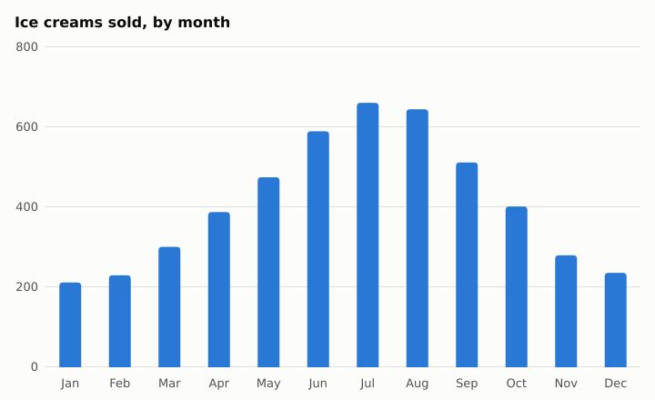
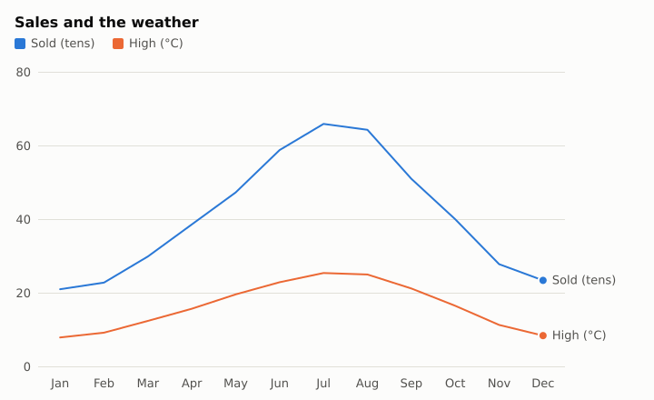

# A data script: statistics and a chart

You have a year of figures, and want the numbers that sum them up, how two of them go together, and a chart
to show someone. [`stats.moth`](https://samyyy2423.github.io/moth/docs/stats.html) has Python's statistics module's means, medians, spread,
quantiles, correlation and a straight line through points; [`charts.moth`](https://samyyy2423.github.io/moth/docs/charts.html) saves bar and line
charts as SVG or PNG.

## The data

A year of an ice-cream stand: each month's average high, in °C, and how many it sold.

```text file=weather.csv
month,high,sales
Jan,8.1,212
Feb,9.4,230
Mar,12.6,301
Apr,15.9,388
May,19.8,475
Jun,23.1,590
Jul,25.6,661
Aug,25.2,645
Sep,21.4,512
Oct,16.7,402
Nov,11.5,280
Dec,8.6,236
```

## The script

```moth file=report.moth
use "stats.moth" as stats
use "charts.moth" as charts
use "text.moth" as text

# each of the numbers times `by`
to scaled with numbers, by
    set made to empty list
    for each n in numbers
        add n * by to made
    end
    return made
end

set rows to read table "weather.csv"
set months to empty list
set highs to empty list
set sales to empty list
for each row in rows
    add month of row to months
    add high of row to highs
    add sales of row to sales
end

say "Ice creams sold a month: mean " text's number_text(stats's mean(sales), 1) ", median " stats's median(sales)
say "spread (standard deviation): " text's number_text(stats's stdev(sales), 1)
say "quartiles: " stats's quantiles(sales, 4)
say "correlation with the day's high: " text's number_text(stats's correlation(highs, sales), 3)

set line to stats's straight_line(highs, sales)
say "each degree warmer sells about " text's number_text(slope of line, 1) " more"
say "at 30 degrees, expect about " (intercept of line + slope of line * 30) rounded

set chart to charts's bar_chart("Ice creams sold, by month", months, sales)
charts's save(chart, "sales.svg")
set both to dictionary where "Sold (tens)" is scaled(sales, 0.1), "High (°C)" is highs
charts's save(charts's line_chart("Sales and the weather", months, both), "sales-and-highs.svg")
```

```console
$ moth run --allow-read --allow-write report.moth
Ice creams sold a month: mean 411.0, median 395
spread (standard deviation): 164.2
quartiles: [247, 395, 570.5]
correlation with the day's high: 0.995
each degree warmer sells about 25.2 more
at 30 degrees, expect about 752
```

A correlation near 1 says the two go up together; `straight_line` is the line closest to the points, by least
squares, as a record of its `slope` and `intercept`, so a temperature it hasn't seen can be guessed from it.

## The charts

`bar_chart` and `line_chart` take a title, the labels along the bottom, and the numbers: a list, or a
dictionary of lists for a series each, in colours that stay apart for colour-blind eyes, with a legend.
`save` writes SVG or PNG by the file's name.





An SVG is sharp at any size and says each bar's number when the mouse is on it; `sized(chart, 1200, 600)` is
the same chart bigger, and `png_of(chart)` its PNG's bytes.

## See also

- [arrays.moth](https://samyyy2423.github.io/moth/docs/arrays.html) for maths on whole tables of numbers at once, as NumPy does.
- [Reading and writing CSV and JSON](csv-and-json.md), for the data's way in and out.
