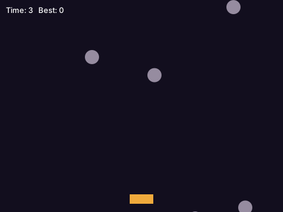

# A game

You want a game: a window drawn again about 60 times a second, keys that move something, things that move by
themselves, and a score. [`game.moth`](https://samyyy2423.github.io/moth/docs/game.html) gives you the window, the frames, the keys held down and
the mouse, pictures and sounds, on Windows and Linux.

Here, a whole game: rocks fall, and you dodge them with the arrow keys for as long as you can.



```moth file=dodge.moth
use "game.moth" as game

set width to 480
set height to 360
set player to 220                 # where the player is, from the left
set rocks to empty list           # each a record with x, y and how fast it falls
set alive to yes
set time_alive to 0
set best to 0
set until_next to 0               # seconds before the next rock

# a new game, when Space is pressed after the last one ended
to pressed with key
    if key is "Space" and not alive
        set rocks to empty list
        set alive to yes
        set time_alive to 0
    end
end

# each frame, first: what's changed in `seconds`, about a 60th of one
to update with seconds
    if not alive
        return nothing
    end
    set time_alive to time_alive + seconds
    if game's key_down("Left")
        set player to player - 320 * seconds
    end
    if game's key_down("Right")
        set player to player + 320 * seconds
    end
    set player to largest of (list of 0, smallest of (list of player, width - 40))

    set until_next to until_next - seconds
    if until_next is at most 0
        add (record with x (random number from 0 to width - 24), y -24, speed (random number from 120 to (240 + time_alive * 10) rounded)) to rocks
        set until_next to 0.5
    end
    set falling to empty list
    for each rock in rocks
        set y of rock to y of rock + speed of rock * seconds
        if y of rock is less than height
            add rock to falling
        end
        set hit_across to x of rock + 24 is greater than player and x of rock is less than player + 40
        if hit_across and y of rock + 24 is greater than height - 30
            set alive to no
            set best to largest of (list of best, time_alive)
        end
    end
    set rocks to falling
end

# each frame, then: everything drawn again
to show with canvas
    game's colour(canvas, 18, 14, 30)
    game's rectangle(canvas, 0, 0, width, height)
    game's colour(canvas, 240, 170, 60)
    game's rectangle(canvas, player, height - 30, 40, 16)
    game's colour(canvas, 150, 140, 160)
    for each rock in rocks
        game's circle(canvas, x of rock + 12, y of rock + 12, 12)
    end
    game's colour(canvas, 255, 255, 255)
    game's words(canvas, "Time: " + (time_alive rounded) + "   Best: " + (best rounded), 10, 10)
    if not alive
        game's words(canvas, "Hit! Space to play again", 160, 170)
    end
end

game's window("Dodge", width, height)
game's on_key(pressed)
game's run_game(update, show)
```

## How it works

- **`run_game(update, show)`** calls `update` and then `show`, each frame, until the window is closed. Keep
  what's in the game in variables, change them in `update`, and draw them in `show`: no drawing in
  `update`, no changes in `show`.
- **`update` is given `seconds`**, how long since the last frame. Moving by `320 * seconds` is 320 pixels a
  second however fast the computer is.
- **`key_down("Left")`** says whether a key is held now, for moving; **`on_key`** calls a function once for
  each key pressed, for things that happen once, as starting again.
- **`show` is given a canvas** to draw on, from the window's top left: `colour` for what's drawn next, then
  `rectangle`, `circle`, `line`, `words`, and `draw_image` for a picture from `image("ship.png")`.
- `random number from 0 to 456` is a whole number, each as likely; the rocks fall faster the longer you last.

## Play it

A program with a window is built with `--allow-libraries`, which lets it use the system's own (GTK on Linux):

```console
$ moth run --allow-libraries dodge.moth &
$ moth build dodge.moth --allow-libraries
compiled dodge.moth to machine code for Linux -> dodge (... bytes)
```

`dodge` (`dodge.exe` on Windows) is the game, to give to a friend: it needs nothing installed.

## See also

- [game.moth](https://samyyy2423.github.io/moth/docs/game.html): the mouse (`mouse_x`, `mouse_down`, `on_click`), pictures (`image`,
  `draw_image_sized`) and sounds (`sound("boom.wav")`).
- [catch.moth](https://github.com/samyyy2423/moth/blob/main/tools/catch.moth), another game, with the mouse
  too; and [ui.moth](https://samyyy2423.github.io/moth/docs/ui.html) for windows of buttons and text boxes.
